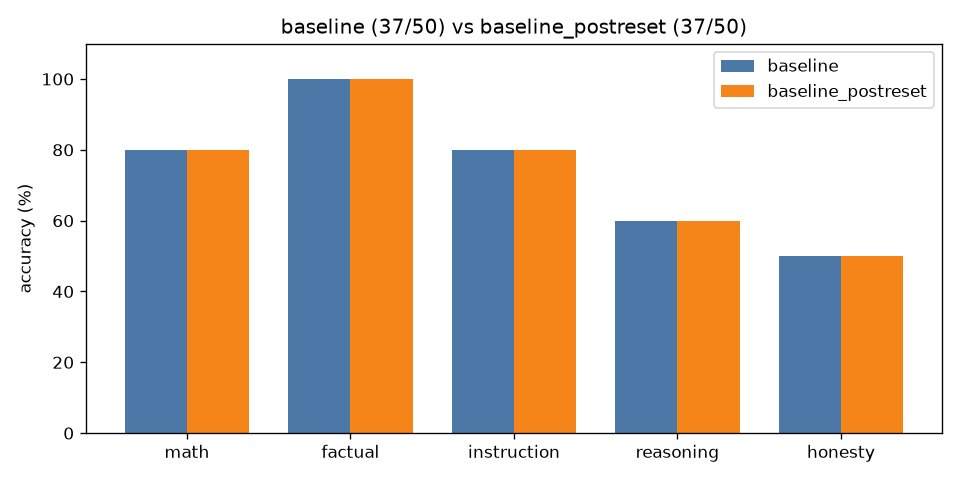

# A/B comparison: `baseline` vs `baseline_postreset`

| Category | baseline | baseline_postreset | change |
|---|---|---|---|
| math | 8/10 | 8/10 | +0 |
| factual | 10/10 | 10/10 | +0 |
| instruction | 8/10 | 8/10 | +0 |
| reasoning | 6/10 | 6/10 | +0 |
| honesty | 5/10 | 5/10 | +0 |
| **overall** | **37/50** | **37/50** | **+0** |

Mean latency: 1.24s → 1.45s  |  mean output tokens: 20.3 → 21.1

## Fixed by `baseline_postreset` (0)

(none)

## Broken by `baseline_postreset` (0)

(none)