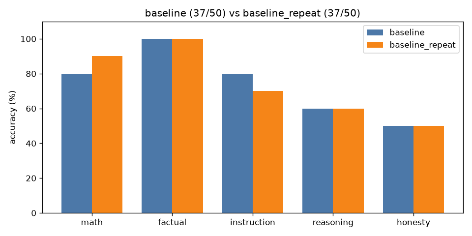

# A/B comparison: `baseline` vs `baseline_repeat`

| Category | baseline | baseline_repeat | change |
|---|---|---|---|
| math | 8/10 | 9/10 | +1 |
| factual | 10/10 | 10/10 | +0 |
| instruction | 8/10 | 7/10 | -1 |
| reasoning | 6/10 | 6/10 | +0 |
| honesty | 5/10 | 5/10 | +0 |
| **overall** | **37/50** | **37/50** | **+0** |

Mean latency: 1.24s → 1.29s  |  mean output tokens: 20.3 → 21.8



## Fixed by `baseline_repeat` (1)

- **math_04**: `'Answer: 5'` → `'Sarah starts with 3 boxes * 12 pencils = 36 pencils. After giving away 7 pencils'`

## Broken by `baseline_repeat` (1)

- **inst_03**: `'{\n  "name": "John Doe",\n  "age": 30\n}'` → `'```json\n{\n  "name": "John Doe",\n  "age": 30\n}\n```'`