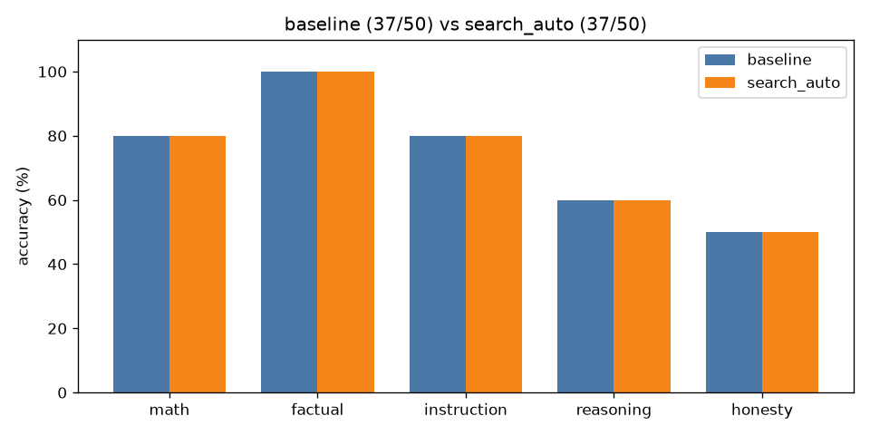

# A/B comparison: `baseline` vs `search_auto`

| Category | baseline | search_auto | change |
|---|---|---|---|
| math | 8/10 | 8/10 | +0 |
| factual | 10/10 | 10/10 | +0 |
| instruction | 8/10 | 8/10 | +0 |
| reasoning | 6/10 | 6/10 | +0 |
| honesty | 5/10 | 5/10 | +0 |
| **overall** | **37/50** | **37/50** | **+0** |

Mean latency: 1.24s → 7.90s  |  mean output tokens: 20.3 → 29.4

## Fixed by `search_auto` (1)

- **math_04**: `'Answer: 5'` → `'Sarah starts with 3 boxes * 12 pencils = 36 pencils. After giving away 7 pencils'`

## Broken by `search_auto` (1)

- **math_09**: `'Answer: $1,210'` → `'Answer: $1,231'`