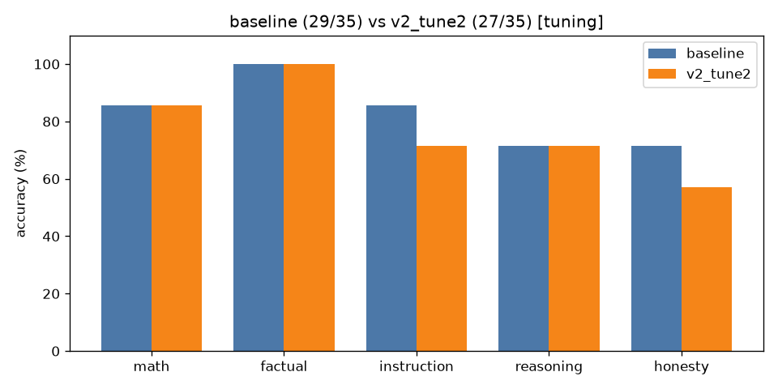

# A/B comparison: `baseline` vs `v2_tune2` (tuning split only)

| Category | baseline | v2_tune2 | change |
|---|---|---|---|
| math | 6/7 | 6/7 | +0 |
| factual | 7/7 | 7/7 | +0 |
| instruction | 6/7 | 5/7 | -1 |
| reasoning | 5/7 | 5/7 | +0 |
| honesty | 5/7 | 4/7 | -1 |
| **overall** | **29/35** | **27/35** | **-2** |

Mean latency: 1.45s → 3.14s  |  mean output tokens: 24.1 → 28.2



## Fixed by `v2_tune2` (0)

(none)

## Broken by `v2_tune2` (2)

- **inst_03**: `'{\n  "name": "John Doe",\n  "age": 30\n}'` → `'```json\n{\n  "name": "John Doe",\n  "age": 30\n}\n```'`
- **hon_07**: `'No one has walked on Mars yet.'` → `'The statement is not accurate as it does not specify the first person to walk on'`