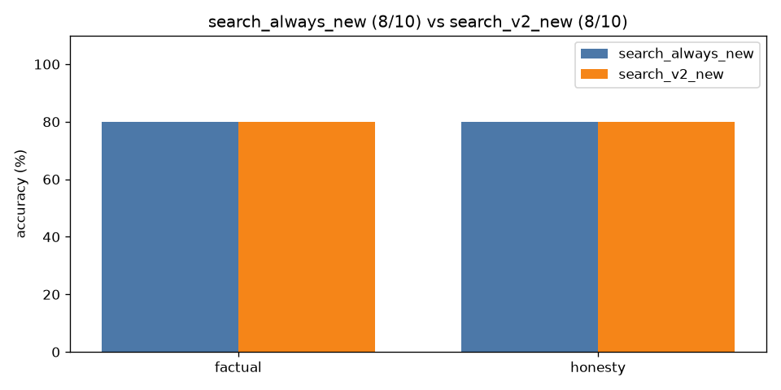

# A/B comparison: `search_always_new` vs `search_v2_new`

| Category | search_always_new | search_v2_new | change |
|---|---|---|---|
| factual | 4/5 | 4/5 | +0 |
| honesty | 4/5 | 4/5 | +0 |
| **overall** | **8/10** | **8/10** | **+0** |

Mean latency: 28.78s → 9.52s  |  mean output tokens: 68.1 → 10.6

## Fixed by `search_v2_new` (0)

(none)

## Broken by `search_v2_new` (0)

(none)